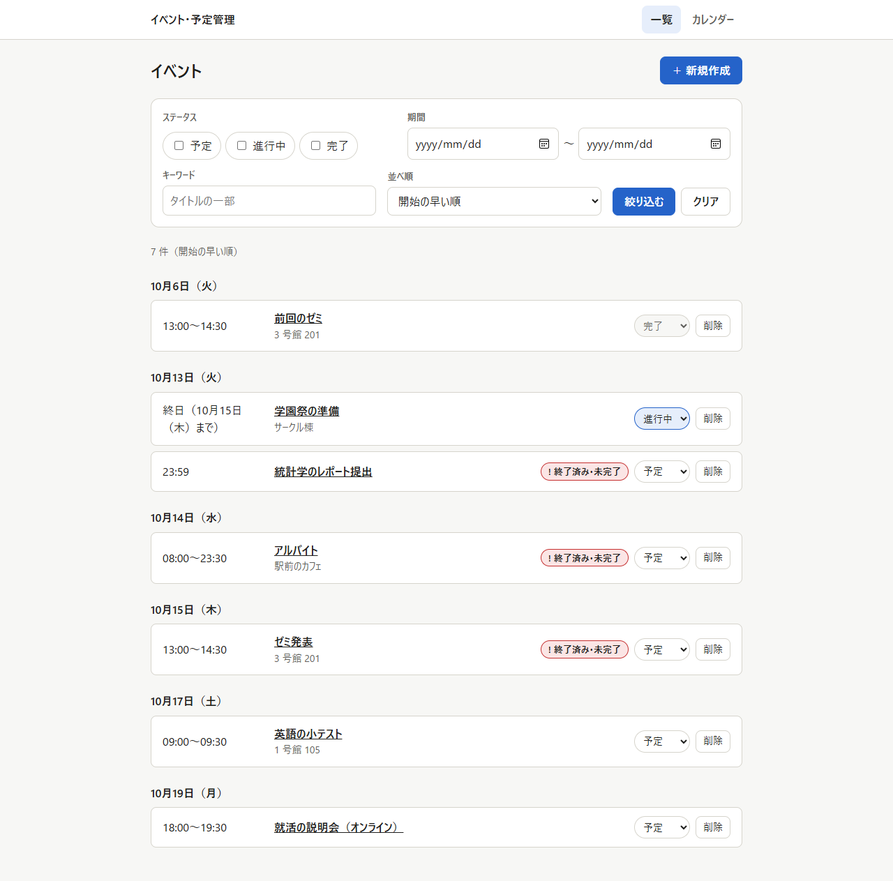
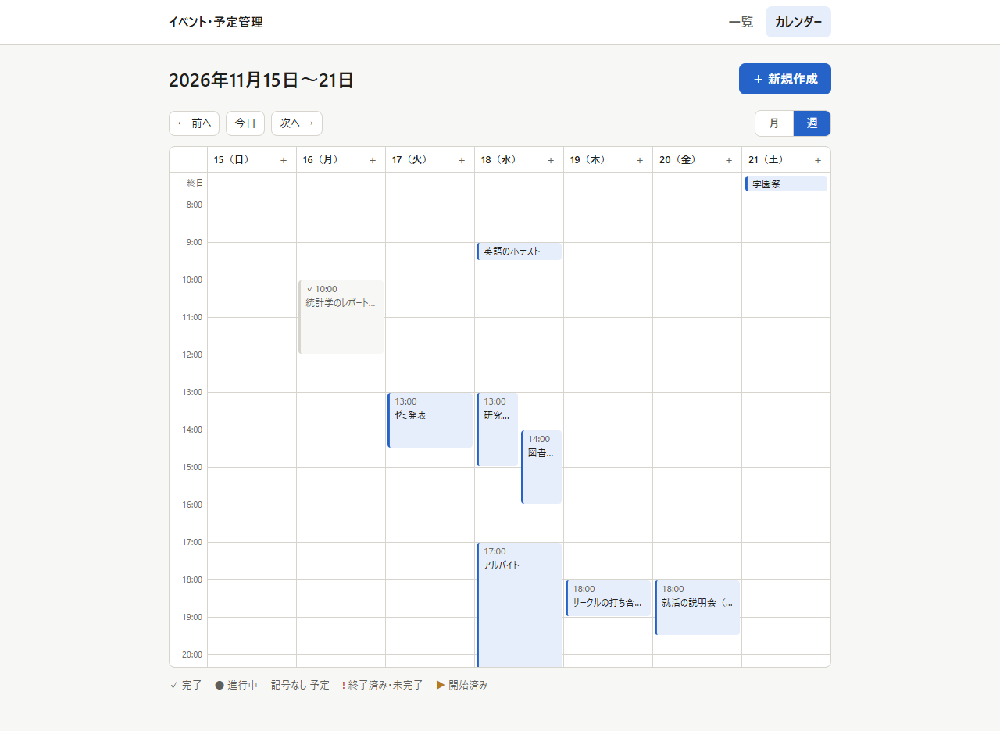
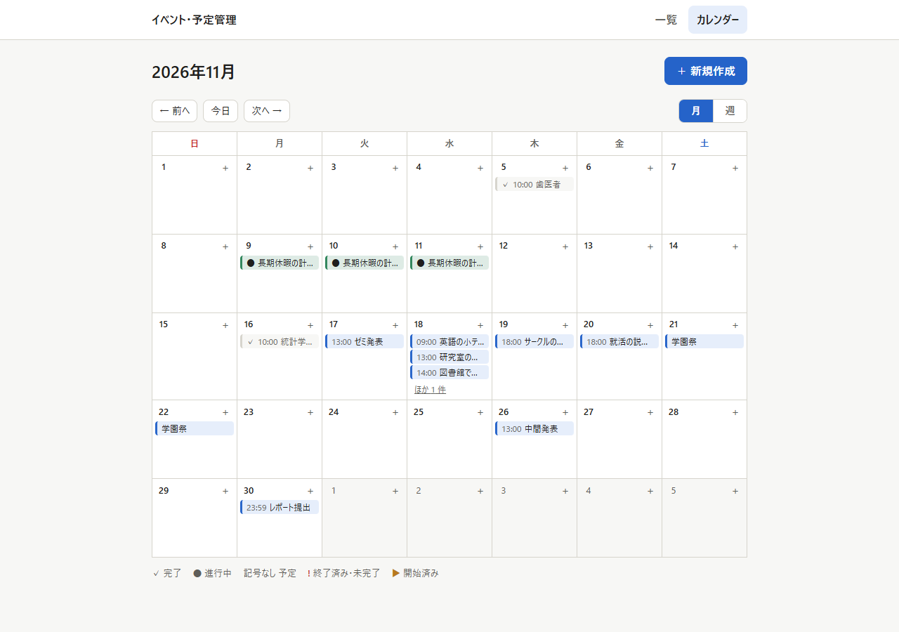
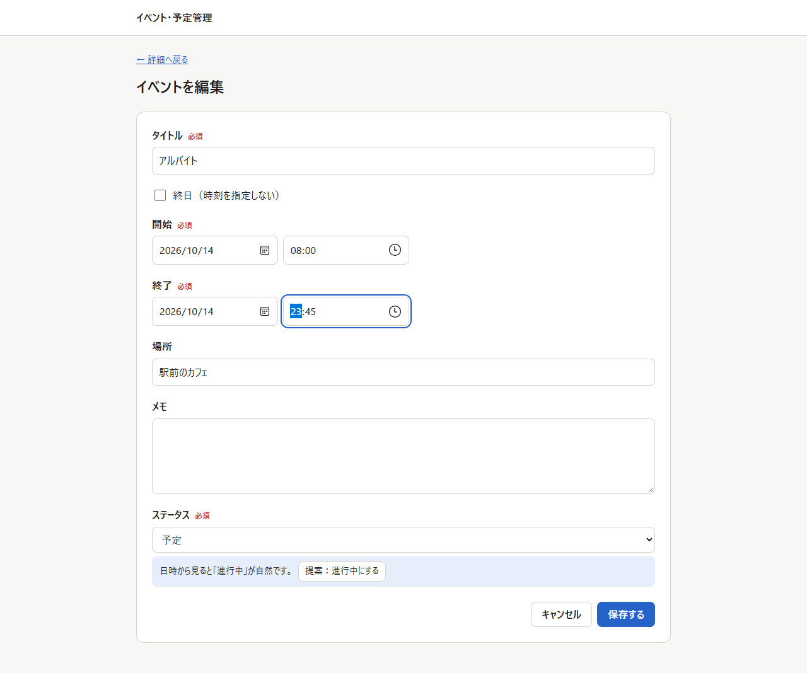
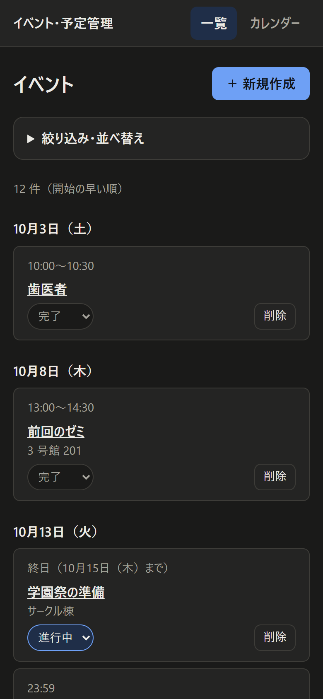

# イベント・予定管理アプリ（events）

イベント・予定を登録し、日時とステータス（予定／進行中／完了）で管理する Web アプリです。Next.js・Prisma・MySQL で作り、AWS（CloudFront → EC2 → RDS）に公開しています。

**公開 URL：https://dpjvt51mn3i90.cloudfront.net**（費用を抑えるため普段は止めています。見せるときに `bash deploy/start.sh` で起動します。[docs/公開環境.md](docs/公開環境.md)）

要件は [docs/要件定義書.md](docs/要件定義書.md) を、開発ルールは [CONTRIBUTING.md](CONTRIBUTING.md) を参照してください。



## できること

- **イベントの作成・一覧・詳細・編集・削除**：タイトル・開始・終了・場所・メモ・ステータスを持つ。削除や入力中のキャンセルは確認ダイアログで確かめる
- **日時の管理**：日本時間で入力・表示する。終日にすると日付だけで入力でき、日をまたぐイベントも扱える。終了は開始より前にできない。一覧は日付ごとの見出しで並ぶ
- **ステータス**：一覧のカード上でその場で切り替えられる。日時から「今ならこのステータス」を提案し（作成フォームの既定値、編集フォームのボタン）、終了を過ぎて完了でないものには「終了済み・未完了」（赤）、開始を過ぎて予定のままのものには「開始済み」（黄）を出す
- **カレンダー**：月表示と週表示で見られる。週表示では時刻のあるイベントを時間軸の上に長さどおりに置く。前へ・今日・次へで移動し、日付の「＋」からその日の作成フォームを開ける。表示中の月・週は URL に入る
- **絞り込み・並べ替え**：ステータス（複数）・期間・キーワードで絞り込み、開始の早い順・遅い順・更新の新しい順に並べる。条件は URL に入るので、再読み込みや URL の共有でも同じ結果になる
- **保存の失敗に強い**：保存に失敗したら理由を表示し、入力内容は消さない
- **スマートフォンとダークモード**：幅 360px から横スクロールなしで使え、OS の設定に合わせてライト／ダークを切り替える

| カレンダー（週表示） | カレンダー（月表示） |
| --- | --- |
|  |  |

| 編集フォームのステータスの提案 | スマートフォン（ダーク） |
| --- | --- |
|  |  |

## 使っている技術

| 区分 | 使うもの |
| --- | --- |
| 画面＋API | Next.js 16（App Router・Route Handler）・React 19・TypeScript・CSS Modules・Zod |
| データベース | MySQL 8.4・Prisma 7 |
| テスト | Vitest・Testing Library（ユニット・API）、Playwright（E2E） |
| 公開環境 | AWS（CloudFront・EC2・RDS・Secrets Manager・EventBridge Scheduler）・Terraform・nginx |
| 自動チェック | GitHub Actions（書式・lint・型チェック・テスト・ビルド・E2E・Terraform） |

## 必要なもの

- Node.js 24
- Docker（開発用の MySQL を動かす）

## 起動方法

クローンしたら最初に 1 回だけ実行します。

```
git config core.hooksPath .githooks
cp .env.example .env
npm ci
docker compose up -d
npx prisma migrate deploy   # テーブルを作る
```

毎回の起動：

```
docker compose up -d   # MySQL（ポート 3306）
npm run dev            # 画面と API（http://localhost:3000）
```

http://localhost:3000/api/health が `{"status":"ok"}` を返せば、DB までつながっています。

`git pull` で `prisma/migrations` に新しいマイグレーションが入ったら、`npx prisma migrate deploy` で DB に反映します。

## よく使うコマンド

| コマンド | 内容 |
| --- | --- |
| `npm run dev` | 開発サーバーを起動（3000 番） |
| `npm run build` | 本番用にビルド |
| `npm run lint` | ESLint（警告もエラー扱い） |
| `npm run typecheck` | TypeScript の型チェック |
| `npm test` | ユニットテストと API テスト（Vitest。下の「テスト」） |
| `npm run test:e2e` | E2E テスト（Playwright。下の「テスト」） |
| `npm run format` / `npm run format:check` | Prettier で整形／整形済みか確認 |
| `npm run db:migrate` | `prisma/schema.prisma` の変更からマイグレーションを作って DB に反映し、Prisma Client を作り直す |

`npm ci` のあとに `prisma generate` が自動で実行され、`src/generated/prisma` に Prisma Client が作られます（git には入れません）。

## フォルダ構成

| フォルダ・ファイル | 役割 |
| --- | --- |
| src/app/ | 画面（ページ）と API（`api/` の下の Route Handler） |
| src/components/ | 画面の部品（フォーム・イベントのカード・カレンダー・確認ダイアログ・メッセージなど） |
| src/lib/ | DB 処理（events.ts）・入力チェック（schema.ts）・日時の計算（date.ts）・カレンダーの日付とイベントの置き方（calendar.ts）・エラー応答（http.ts） |
| prisma/ | テーブル定義とマイグレーション |
| tests/unit/ | ユニットテスト |
| tests/api/ | API テスト（Route Handler をテスト用の DB で動かす） |
| tests/e2e/ | E2E テスト（Playwright） |
| compose.yaml, docker/ | 開発用の MySQL |
| deploy/ | 公開環境（Terraform、EC2 の設定、デプロイ・起動・停止のスクリプト） |
| docs/ | 要件定義書、公開環境の説明、README のスクリーンショット（images/） |

## 画面

| URL | 画面 | できること |
| --- | --- | --- |
| / | 一覧 | 開始日ごとにイベントを並べる。ステータス（複数）・期間・キーワードで絞り込み、並べ替える（条件は URL に入る）。ステータスをその場で切り替える。詳細へ移る・削除する |
| /calendar | カレンダー | 月表示（既定）と週表示（`?view=week&date=2026-10-20`）。イベントから詳細へ、日付の「＋」からその日の作成フォームへ。スマートフォンの幅では、月は件数、週は日ごとの一覧になる |
| /events/new | 作成 | タイトル・開始・終了（終日なら日付だけ）・場所・メモ・ステータスを入れて作成。`?date=2026-10-20` ならその日の 9:00〜10:00 を入れておく |
| /events/{id} | 詳細 | 全項目と作成・更新日時。編集・削除 |
| /events/{id}/edit | 編集 | 作成と同じフォームで変更 |

日時はすべて日本時間で入力・表示します。ステータスは利用者が選んだ値を保存し、日時からの提案は作成フォームの既定値と編集フォームのボタンで示します。一覧では、終了を過ぎて完了でないものに「終了済み・未完了」（赤）、開始を過ぎて予定のままのものに「開始済み」（黄）を出します。削除と、入力中のキャンセルは確認ダイアログで確かめます。

## API

画面と同じサーバー（http://localhost:3000）で動きます。日時は時差付きの ISO 8601（例：`2026-10-20T13:00:00+09:00`）で送り、UTC（末尾 `Z`）で返ります。詳しくは要件定義書「6. API」。

| メソッド | パス | 内容 | 成功時 |
| --- | --- | --- | --- |
| GET | /api/events | 一覧。`status`（カンマ区切り）・`from`/`to`（YYYY-MM-DD、日本時間）・`q`（タイトルの一部）・`sort`（`startAt`・`-startAt`・`-updatedAt`） | 200 |
| POST | /api/events | 作成 | 201 |
| GET | /api/events/{id} | 1 件 | 200 |
| PUT | /api/events/{id} | 更新（全項目） | 200 |
| PATCH | /api/events/{id}/status | ステータスだけ変更 | 200 |
| DELETE | /api/events/{id} | 削除 | 204 |
| GET | /api/health | サーバーと DB の確認 | 200 |

入力の誤りは 400、存在しない id は 404 で、`{ "message": "...", "errors": { "項目": ["メッセージ"] } }` を返します。

## テスト

`npm test` でユニットテストと API テストを両方実行します（`npm run test:unit` / `npm run test:api` で片方だけ）。API テストは開発用の MySQL の中に `events_test` という別の DB を作って使い、テストのたびに中身を消します。先に `docker compose up -d` で MySQL を起動しておいてください。

`npm run test:e2e` は、画面を実際のブラウザで操作して主な流れ（作成 → 編集 → ステータス変更 → 絞り込み → 削除、カレンダーの月・週の切り替えと移動など）を確かめます。`events_e2e` という別の DB にマイグレーションを当て、本番用にビルドしたサーバーを 3000 番で起動して動かします（テストのたびにデータを消すので、開発用のデータは消えません）。

- 3000 番は開発サーバーと同じなので、`npm run dev` を止めてから実行してください
- 手元では PC の Microsoft Edge を使います（CI では Playwright の Chromium）
- 失敗したときは `test-results/` のトレースを `npx playwright show-trace <trace.zip>` で見られます

Pull Request と main への push のたびに、GitHub Actions（`.github/workflows/ci.yml`）が書式・lint・型チェック・ユニット＋API テスト・ビルド・E2E テストを実行します。
