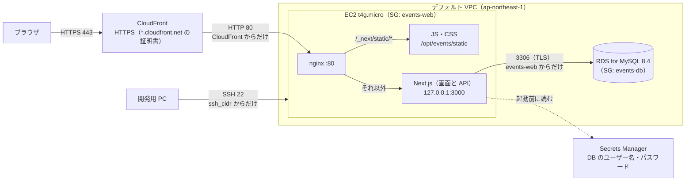

# 公開環境（AWS）

公開 URL は https://dpjvt51mn3i90.cloudfront.net 。AWS の東京リージョン（ap-northeast-1）で、kadai と同じ CloudFront → EC2 1 台 → RDS の構成で動かす。環境は Terraform で作り、アプリは `bash deploy/deploy.sh` で反映する。費用を抑えるため、普段は EC2 と RDS を止めておき、見せるときだけ `bash deploy/start.sh` で起動する（毎日 5:00 に自動で止まる）。

設定値は主なものだけを書く。正確な値は [deploy/](../deploy/) のコードを見る。

## 目次

- [構成図](#構成図)
- [リソースと主な設定](#リソースと主な設定)
- [ファイルの置き場所](#ファイルの置き場所)
- [初めて環境を作る](#初めて環境を作る)
- [起動と停止](#起動と停止)
- [デプロイする](#デプロイする)
- [運用](#運用)
- [費用](#費用)
- [後片付け](#後片付け)
- [困ったとき](#困ったとき)

## 構成図



- 画面と API を同じ Next.js が返すので、画面のコードは開発中と同じ（`/api` への相対パス）で動き、CORS の設定は要らない
- CloudFront は `/_next/static/*`（ファイル名に中身のハッシュが入った JS・CSS）だけをキャッシュする。画面は DB の中身を表示し、絞り込みの条件を URL に持つので、API と同じくキャッシュせずにすべて EC2 へ渡す
- Next.js と DB は、インターネットから直接は届かない

## リソースと主な設定

| リソース | 主な設定 | コード |
| --- | --- | --- |
| CloudFront | ブラウザ側は HTTPS のみ（HTTP はリダイレクト）。オリジンは EC2 の 80 番に HTTP。`/_next/static/*` はキャッシュ、それ以外はキャッシュなし・全メソッド・ヘッダーとクエリ文字列を転送。価格帯 PriceClass_200 | [cloudfront.tf](../deploy/terraform/cloudfront.tf) |
| EC2 | t4g.micro（ARM・1 GB）、Amazon Linux 2023、EBS gp3 10 GB（暗号化あり）、スワップ 2 GB。CPU クレジットは standard（追加料金なし）。Elastic IP 付き | [main.tf](../deploy/terraform/main.tf)、[user-data.sh](../deploy/terraform/user-data.sh) |
| セキュリティグループ `events-web`（EC2） | 受信は 80 番（CloudFront のプレフィックスリスト）と 22 番（`ssh_cidr`）だけ | [main.tf](../deploy/terraform/main.tf) |
| IAM ロール `events-ec2` | EC2 に付ける。DB のシークレットを読む権限だけ | [main.tf](../deploy/terraform/main.tf)、[rds.tf](../deploy/terraform/rds.tf) |
| RDS | MySQL 8.4、db.t4g.micro、gp3 20 GB（暗号化あり）、シングル AZ、パブリックアクセスなし。自動バックアップ 1 日（無料プランの上限）。削除保護あり | [rds.tf](../deploy/terraform/rds.tf) |
| セキュリティグループ `events-db`（RDS） | 受信は 3306 番を `events-web` からだけ | [rds.tf](../deploy/terraform/rds.tf) |
| Secrets Manager | DB のパスワードは RDS が作って保存する（Terraform の state にも残らない）。7 日ごとに自動で変わる | [rds.tf](../deploy/terraform/rds.tf) |
| EventBridge Scheduler | 毎日 5:00（日本時間）に EC2 と RDS を止める。IAM ロール `events-scheduler` は、この EC2 と RDS を止める権限だけ | [scheduler.tf](../deploy/terraform/scheduler.tf) |

EC2 の中の設定は次のとおり。どれも `deploy.sh` が [deploy/server/setup.sh](../deploy/server/setup.sh) で毎回最新にする。

| 何 | 設定 | ファイル |
| --- | --- | --- |
| Node.js・nginx | Node.js 24（開発・CI と同じ）と nginx を dnf で入れる | [setup.sh](../deploy/server/setup.sh) |
| nginx | 80 番で受け、`/_next/static/` は `/opt/events/static` から直接返す（1 年のキャッシュ）。それ以外は 127.0.0.1:3000 へ転送し、画面を後から流して表示できるようバッファしない | [nginx.conf](../deploy/server/nginx.conf) |
| Next.js | systemd の `events` サービス。`next build` の standalone 出力を `node server.js` で動かす。ユーザー `events` で動かし、ヒープは 384 MB。落ちても EC2 を再起動しても自動で起動する | [events.service](../deploy/server/events.service) |
| DB の接続情報 | 起動前に Secrets Manager から読み、`/run/events/env`（root だけが読める）に `DATABASE_URL` として書いて Next.js に渡す。DB とは TLS でつなぎ、RDS の証明書を確かめる | [db-secret.sh](../deploy/server/db-secret.sh) |
| パスワードの変化の確認 | 10 分ごとに確かめ、変わっていたら Next.js を再起動する | [events-db-secret-check.timer](../deploy/server/events-db-secret-check.timer) |

## ファイルの置き場所

```
deploy/
├── deploy.sh                 デプロイ（ビルド → EC2 へ転送 → マイグレーション → 再起動 → 確認）
├── start.sh                  止めてある RDS と EC2 を起動し、動くまで待つ
├── stop.sh                   EC2 と RDS を止める
├── server/                   EC2 の設定（deploy.sh が毎回 EC2 に入れる）
│   ├── setup.sh                  Node.js・nginx の導入と設定ファイルの配置
│   ├── nginx.conf                → /etc/nginx/conf.d/events.conf
│   ├── events.service            → /etc/systemd/system/（Next.js）
│   ├── db-secret.sh              → /opt/events/bin/（DB の接続情報を読む）
│   └── events-db-secret-check.*  → /etc/systemd/system/（パスワードの変化の確認）
└── terraform/                AWS の環境
    ├── versions.tf               Terraform とプロバイダーのバージョン
    ├── variables.tf              変数（region・instance_type・rds_deletion_protection・ssh_cidr）
    ├── main.tf                   EC2・Elastic IP・キーペア・events-web・IAM ロール
    ├── rds.tf                    RDS・events-db・シークレットを読む権限
    ├── cloudfront.tf             CloudFront
    ├── scheduler.tf              毎日 5:00 に EC2 と RDS を止める
    ├── outputs.tf                公開 URL・接続先など（deploy.sh が読む）
    └── user-data.sh              EC2 の初回起動時の準備（スワップ）
```

手元にだけあり、リポジトリに入れないもの（`.gitignore` 済み）：

| ファイル | 中身 | 注意 |
| --- | --- | --- |
| `deploy/terraform/terraform.tfvars` | `ssh_cidr`（自分のグローバル IP） | |
| `deploy/terraform/events.pem` | SSH の秘密鍵（Terraform が作る） | 他の人に渡さない |
| `deploy/terraform/terraform.tfstate` | Terraform が作ったものの記録 | SSH の秘密鍵も入っている。消すと Terraform で管理できなくなる |

EC2 の中は次のとおり。

| 場所 | 中身 |
| --- | --- |
| `/opt/events/app/` | Next.js の standalone 出力（`server.js` と必要な `node_modules`） |
| `/opt/events/static/` | JS・CSS（前のデプロイの分も残す） |
| `/opt/events/migrate/` | マイグレーション用の Prisma CLI と `prisma/` |
| `/opt/events/COMMIT` | 反映したコミット |

## 初めて環境を作る

必要なもの：開発で使っている Node.js・Git Bash に加えて、AWS CLI v2 と Terraform 1.9 以上。AWS CLI は `aws configure` でリージョン `ap-northeast-1` を設定し、`aws sts get-caller-identity` でアカウントが表示されることを確かめる（作業は IAM ユーザーで行う）。

1. `deploy/terraform/terraform.tfvars` を作る

   ```
   ssh_cidr = "203.0.113.10/32"   # 自分のグローバル IP（curl https://checkip.amazonaws.com で調べる）
   ```

2. 環境を作る（RDS は 6 分、CloudFront は 4 分ほどかかる）。plan で、作られるものと費用（[費用](#費用)）を確かめてから apply する

   ```
   cd deploy/terraform
   terraform init
   terraform plan -out=tfplan
   terraform apply tfplan
   terraform output url
   ```

3. `events` フォルダに戻り、[デプロイする](#デプロイする)。テーブルはデプロイのときに `prisma migrate deploy` が作る。最初はイベントが 0 件の状態で始まる

2026 年 10 月 14 日にこの手順で作った（apply は 21 件で約 7 分、初回のデプロイは約 3 分）。

## 起動と停止

普段は止めておき、見せるときだけ起動する。`events` フォルダで、Git Bash から実行する。

```
bash deploy/start.sh   # RDS → EC2 の順に起動し、公開 URL で動くまで待つ（5〜10 分）
bash deploy/stop.sh    # EC2 と RDS を止める（RDS が止まりきるのは数分後）
```

- データは RDS に残る
- 止め忘れても、毎日 5:00（日本時間）に EventBridge Scheduler が止める。RDS は止めて 7 日たつと AWS が自動で起動するが、それも翌朝 5:00 に止まる
- 止めている間に公開 URL を開くと、CloudFront のエラー（502 / 504）になる
- 止めている間は `deploy.sh` を使えない（SSH できない）。先に `start.sh` を実行する

## デプロイする

CI が通った main を反映する。`events` フォルダで、Git Bash から実行する。

```
git switch main
git pull
bash deploy/deploy.sh
```

- 手元で `npm ci` と `npm run build` を実行し、standalone 出力を EC2 へ送る。テストと lint は CI で実行済みのものとして飛ばす
- 2〜3 分かかる。最後に公開 URL で `/api/health` と画面を確かめ、失敗したら Next.js のログを出して止まる
- コミットしていない変更があると止まる。反映したコミットは EC2 の `/opt/events/COMMIT` に残る
- DB の変更は Prisma のマイグレーション（`npx prisma migrate dev --name <内容>` で作る）として足せば、デプロイのときに `prisma migrate deploy` で当たる。データはそのまま残る
- Next.js を入れ替える数秒は、画面と API が応答しない（サーバー 1 台なので）

## 運用

### ログと状態を見る

```
cd deploy/terraform
ssh -i events.pem ec2-user@$(terraform output -raw public_dns)
sudo journalctl -u events -f          # Next.js のログ
systemctl status events nginx         # 動いているか
cat /opt/events/COMMIT                # 反映しているコミット
```

### Terraform の設定を変える

Issue → ブランチ → PR で `deploy/terraform/` を変え、`terraform plan` で差分を確かめてから `terraform apply` する。EC2 や RDS が「replace」（作り直し）になっていないかを必ず見る。RDS が作り直しになるとデータが消える。EC2 が作り直しになったら、apply のあと `bash deploy/deploy.sh` でアプリを入れ直す（それまでサイトは止まる。Elastic IP は同じものが付くので、URL や CloudFront は変わらない）。

### RDS

- RDS には削除保護を付けている（変数 `rds_deletion_protection`、既定 `true`）。`terraform destroy` などで RDS を消そうとすると、AWS が拒否して apply が失敗する
- データを残したまま費用を抑えるには、[起動と停止](#起動と停止) のとおり止めておく
- バックアップは RDS が毎日自動で取る（1 日分）。大きな変更の前は手でスナップショットを取る：`aws rds create-db-snapshot --db-instance-identifier events-db --db-snapshot-identifier events-$(date +%Y%m%d)`

## 費用

AWS アカウントは無料プラン（kadai と同じアカウント）。クレジットの残りは 159.56 ドル、期限は 2027 年 4 月 11 日（2026 年 10 月 14 日に `aws freetier get-account-plan-state` で確認）。無料プランではクレジットを超えて請求されることはないが、使い切るか期限が来るとアカウントが閉じる（90 日以内に有料プランにしなければデータも消える）。

| リソース | 動かしているとき（月額の目安） | 止めているとき |
| --- | --- | --- |
| EC2 t4g.micro | 約 8 ドル | 0 ドル |
| RDS db.t4g.micro | 約 17 ドル | 0 ドル |
| RDS のストレージ 20 GB | 約 2.5 ドル | 約 2.5 ドル |
| パブリック IPv4（Elastic IP） | 約 3.6 ドル | 約 3.6 ドル |
| EBS gp3 10 GB | 約 1 ドル | 約 1 ドル |
| Secrets Manager（シークレット 1 つ） | 約 0.4 ドル | 約 0.4 ドル |
| CloudFront・EventBridge Scheduler | ほぼ 0 ドル | ほぼ 0 ドル |
| 合計（1 か月ずっと） | 約 33 ドル | 約 7.5 ドル |

金額は東京リージョンの単価からの概算。動かしている時間の分だけ「動かしているとき」の額に近づく。kadai の公開環境も同時に作ると、ほぼ 2 倍になる（要件定義書 N-12）。実際の減り方は `aws freetier get-account-plan-state` で確かめる。

## 後片付け

採点が終わったら、Terraform で作ったものをまとめて消す。RDS のデータも消えるので、残すなら先にスナップショットを取る。RDS の削除保護を先に外してから消す。

```
cd deploy/terraform
terraform apply -var rds_deletion_protection=false   # 削除保護を外す（1〜2 分）
terraform destroy -var rds_deletion_protection=false # CloudFront の無効化と削除に 5〜15 分かかる
```

そのあと、手元の `events.pem` と `terraform.tfstate` は消してよい。最後に EC2 コンソールの「Global View」で、何も残っていないことを確かめる。

## 困ったとき

| 症状 | よくある原因 | 確かめ方・直し方 |
| --- | --- | --- |
| SSH や `deploy.sh` がタイムアウトする | EC2 が止まっている（毎日 5:00 に止まる）か、自分のグローバル IP が変わった | `bash deploy/start.sh` で起動する。動いているのにつながらないなら、`terraform.tfvars` の `ssh_cidr` を今の IP に直して `terraform apply` |
| SSH や `deploy.sh` が「REMOTE HOST IDENTIFICATION HAS CHANGED」で止まる | EC2 を作り直したので、SSH のホスト鍵が変わった | `ssh-keygen -R $(terraform output -raw public_dns)` で古い鍵を消してから、もう一度実行する |
| `deploy.sh` が「サーバーが 1 分以内に起動しませんでした」で止まる | DB につながらない、メモリ不足 | 表示されたログを見る。`Access denied` なら下の行、メモリ不足なら `free -m` でスワップがあるか |
| `prisma migrate deploy` が失敗する | 適用済みのマイグレーションを書き換えた、DB につながらない | 適用済みのマイグレーションは変えず、新しいマイグレーションで直す。つながらないなら RDS が起動しているか（`start.sh`） |
| `Access denied for user` | RDS がパスワードを変えた直後 | 10 分以内に自動で再起動される。すぐ直すなら EC2 で `sudo systemctl restart events` |
| apply が「Cannot delete protected DB Instance」で失敗する | RDS の削除保護 | 意図して消すときだけ `-var rds_deletion_protection=false` で apply してからやり直す |
| CloudFront が 502 / 504 を返す | EC2 が止まっている、nginx か Next.js が止まっている | `start.sh` で起動する。動いているなら EC2 で `systemctl status nginx events` |
| 更新したのに古い画面が出る | ブラウザのキャッシュ | スーパーリロード。画面そのものは CloudFront でキャッシュしていない |
| `terraform plan` が「does not match any of the checksums」で失敗する | プロバイダーの実行ファイルがウイルス対策ソフトなどに消された | `terraform init` で入れ直す |
| 全体が重い | CPU クレジットを使い切った（standard なので速度が落ちる） | EC2 でビルドなど重い処理をしていないか（ビルドは手元で行っている） |
