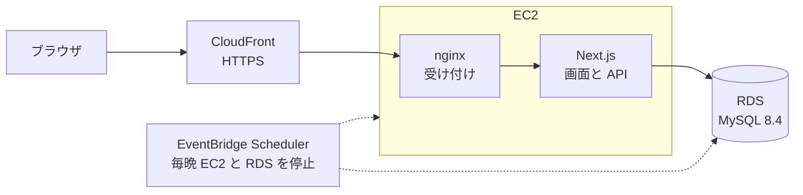

# イベント・予定管理アプリ 要件定義書

更新日: 2026-10-13 · 作成: @神崎

## 1. 概要

Next.js・Prisma・MySQL で、イベント・予定を登録し、日時とステータス（予定／進行中／完了）で管理する Web アプリを作る。初期リリースは一覧での管理までとし、後でカレンダー表示を追加する。

| 項目 | 内容 |
| --- | --- |
| アプリ名 | イベント・予定管理アプリ（events） |
| 目的 | 講義課題の提出物。kadai（Spring Boot・React）とは違うスタックで、フルスタックの Web アプリ開発を学ぶ |
| 想定利用者 | 作成者本人 1 人（ログインなし） |
| 利用場面 | 授業・締め切り・予定などを登録し、これからのもの・進行中のもの・終わったものを見分ける |
| 初期リリースの範囲 | イベントの CRUD、日時管理、ステータス、一覧の絞り込み・並べ替え、テスト・CI、AWS への公開 |
| 今回は作らないもの | カレンダー表示（7. 今後の拡張）、ログイン・複数ユーザー、繰り返しイベント、通知 |
| リポジトリ | https://github.com/y0408e0301-star/events |

## 2. 機能要件

必須は F-01〜F-03、初期リリースに含めるのは F-01〜F-06。

| ID | 機能 | 詳しい内容 | 優先度 |
| --- | --- | --- | --- |
| F-01 | イベントの CRUD | イベントを作成・一覧表示・詳細表示・編集・削除できる。削除の前に確認する | 必須 |
| F-02 | 日時管理 | 開始日時・終了日時を持つ。終了は開始より前にできない。「終日」にすると日付だけで入力する。一覧は日付ごとにまとめて表示する | 必須 |
| F-03 | ステータス | 予定／進行中／完了の 3 つ。保存するのはユーザーが選んだ値。一覧のカード上でその場で切り替えられる（自動の提案は下の表） | 必須 |
| F-04 | 絞り込み・並べ替え | ステータス（複数選択可）・期間・タイトルの一部で絞り込む。開始日時の早い順（既定）・遅い順・更新の新しい順に並べられる。条件は URL に残り、再読み込みしても消えない | 初期リリース |
| F-05 | データの保存 | 変更するたびに MySQL に保存する。失敗したら理由を表示し、入力内容は消さない | 初期リリース |
| F-06 | Web 公開 | AWS に公開し、URL を開くだけで使える（6. 非機能要件） | 初期リリース |
| F-07 | カレンダー表示 | 月・週のカレンダーにイベントを並べる（7. 今後の拡張） | 後日 |

### ステータスの自動の提案と注意表示

日時から「今ならこのステータス」を提案するが、勝手には変えない。

| 今の時刻 | 提案するステータス |
| --- | --- |
| 開始より前 | 予定 |
| 開始〜終了 | 進行中 |
| 終了より後 | 完了 |

- 作成フォーム：ステータスの既定値を提案値にする
- 編集フォーム：日時を変えて提案値と違うとき、「提案：進行中にする」ボタンを出す
- 一覧：終了を過ぎて完了でないものは「終了済み・未完了」（赤）、開始を過ぎて予定のままのものは「開始済み」（黄）を表示する

## 3. データ項目

テーブルは events の 1 つ。日時は DB に UTC で保存し、画面では日本時間（Asia/Tokyo）で表示する。

| 項目 | 型 | 必須 | 入力ルール |
| --- | --- | --- | --- |
| id | 整数（自動採番） | 自動 |  |
| title（タイトル） | 文字列 | 必須 | 1〜100 文字。空白だけは不可 |
| description（メモ） | 文字列 | 任意 | 1000 文字まで |
| location（場所） | 文字列 | 任意 | 100 文字まで |
| startAt（開始日時） | 日時 | 必須 |  |
| endAt（終了日時） | 日時 | 必須 | 開始日時以降 |
| allDay（終日） | 真偽値 | 必須 | 終日なら開始はその日の 0:00、終了は最終日の 23:59:59.999 |
| status（ステータス） | SCHEDULED（予定）／IN\_PROGRESS（進行中）／DONE（完了） | 必須 |  |
| createdAt・updatedAt | 日時 | 自動 |  |

検索を速くするため、startAt と（status, startAt）に索引を付ける。

## 4. 画面

画面は 4 つ。作成と編集は同じフォームを使う。

| URL | 画面 | 内容 |
| --- | --- | --- |
| / | 一覧 | 日付ごとの見出しの下にイベントを並べる。各イベントに日時・場所・ステータス・注意表示。ステータスの切り替え、編集・削除への入口。上部に絞り込み・並べ替え。件数が 0 なら「イベントはありません」と作成ボタン |
| /events/new | 作成 | タイトル・開始・終了・終日・場所・メモ・ステータス。終日にすると日付だけの入力に切り替える |
| /events/\[id\] | 詳細 | 全項目と作成・更新日時。編集・削除ボタン |
| /events/\[id\]/edit | 編集 | 作成と同じフォームに今の値を入れて表示 |

- 入力エラーは各項目の下に表示する（API が返すエラーも項目に割り当てる）
- 保存・削除の結果は画面上部のメッセージで知らせる
- 存在しない id を開いたら「イベントが見つかりません」を表示する

## 5. API

JSON でやり取りする REST API を Next.js の Route Handler で作る。日時は ISO 8601（例：2026-10-20T09:00:00+09:00）で受け取り、UTC（末尾 Z）で返す。

| メソッド | パス | 内容 | 成功時 |
| --- | --- | --- | --- |
| GET | /api/events | 一覧。絞り込み・並べ替えは下のクエリ | 200 |
| POST | /api/events | 作成 | 201 |
| GET | /api/events/{id} | 1 件 | 200 |
| PUT | /api/events/{id} | 更新（全項目） | 200 |
| PATCH | /api/events/{id}/status | ステータスだけ変更 | 200 |
| DELETE | /api/events/{id} | 削除 | 204 |

一覧のクエリ：

| クエリ | 意味 | 例 |
| --- | --- | --- |
| status | ステータス（カンマ区切りで複数） | status=SCHEDULED,IN\_PROGRESS |
| from・to | この期間に一部でも重なるイベント | from=2026-10-01&to=2026-10-31 |
| q | タイトルの一部 | q=レポート |
| sort | startAt（既定）・-startAt・-updatedAt | sort=-startAt |

エラーは次の形で返す。入力の誤りは 400、存在しない id は 404、予期しない失敗は 500。

```json
{ "message": "入力内容を確かめてください", "errors": { "endAt": ["終了は開始より後にしてください"] } }
```

## 6. 非機能要件

画面と API を Next.js 1 つで動かし、データは MySQL に保存する。公開は kadai と同じ CloudFront → EC2 → RDS の構成にする。



nginx はすべてのリクエストを Next.js に渡し、Next.js が画面と /api の両方を返す。

| 部分 | 使うもの |
| --- | --- |
| 画面＋API | Next.js 16（App Router）・React 19・TypeScript（strict） |
| スタイル | CSS Modules。OS の設定に合わせてダークモード |
| データベース | MySQL 8.4。テーブルの作成・変更は Prisma のマイグレーション |
| 入力チェック | Zod。画面と API で同じルールを使う |
| テスト | Vitest（ユニット・画面部品・API を実際の MySQL で）、Playwright（主な操作の通し） |
| コードチェック | ESLint・Prettier・型チェック。GitHub Actions で PR ごとに実行 |
| 公開先 | AWS：CloudFront（HTTPS）→ EC2（nginx → Next.js）→ RDS（MySQL）。Terraform で作る |
| 開発時のポート | Next.js 3000、MySQL 3306 |

- 時刻：DB は UTC、画面は Asia/Tokyo。日時の計算は 1 か所にまとめ、テストでは「今」を固定する
- アクセシビリティ：すべての入力にラベルを付け、キーボードだけで操作できる。メッセージは読み上げソフトにも伝わるようにする
- 対応ブラウザ：Chrome・Edge・Safari の最新版。スマートフォンの幅でも崩れない
- 費用：kadai と合わせて RDS が 2 台になるため、公開環境は普段は止め、毎晩自動で停止する

## 7. 今後の拡張

カレンダー表示（F-07）は、初期リリースの仕組みをそのまま使って追加できるようにしておく。

- データの取得：表示する月・週の範囲を GET /api/events の from・to に渡す（日をまたぐイベントも取れる）
- 日付の計算：月の初日・最終日、日ごとの振り分けは一覧で使う関数を使い回す
- 画面：/calendar を追加し、一覧とタブで切り替える。日付を選ぶとその日で作成フォームを開く
- 未決事項：ライブラリ（FullCalendar など）を使うか自作するか、ドラッグで日時を変えられるようにするか
