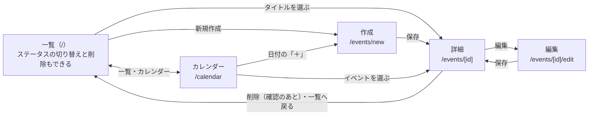
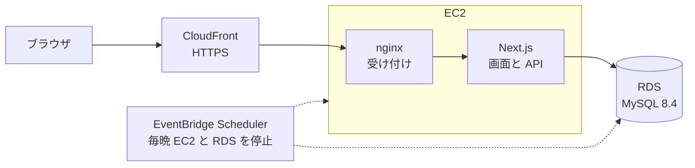

# イベント・予定管理アプリ 要件定義書

更新日: 2026-10-13 · 作成: @神崎

## 1. 概要

Next.js・Prisma・MySQL で、イベント・予定を登録し、日時とステータス（予定／進行中／完了）で管理する Web アプリを作る。初期リリースは一覧での管理までとし、そのあとカレンダー表示（月・週）を追加する。

| 項目 | 内容 |
| --- | --- |
| アプリ名 | イベント・予定管理アプリ（events） |
| 目的 | 講義課題の提出物。kadai（Spring Boot・React）とは違うスタックで、フルスタックの Web アプリ開発を学ぶ |
| 想定利用者 | 作成者本人 1 人（ログインなし） |
| 利用場面 | 授業・締め切り・予定などを登録し、これからのもの・進行中のもの・終わったものを見分ける |
| 初期リリースの範囲 | イベントの CRUD、日時管理、ステータス、一覧の絞り込み・並べ替え、テスト・CI、AWS への公開 |
| 初期リリースのあとに足すもの | カレンダー表示（月・週）。ステップ 11 |
| 今回は作らないもの | ログイン・複数ユーザー、繰り返しイベント、通知（10. 対象外） |
| リポジトリ | https://github.com/y0408e0301-star/events |

## 2. 用語

この文書と画面では、次の言葉を次の意味で使う。

| 用語 | 意味 | 例 |
| --- | --- | --- |
| イベント | 日時を持つ 1 つの予定。このアプリで管理する単位 | 「ゼミ発表」「レポート提出」 |
| 開始日時・終了日時 | イベントが始まる日時と終わる日時。同じでもよい（締め切りのような「その瞬間」の予定） | 10/20 13:00〜14:30 |
| 終日 | 時刻を持たず、日付だけで決めるイベント。複数日にまたがってもよい | 学園祭（10/25〜10/26） |
| ステータス | イベントの進み具合。予定・進行中・完了の 3 つ。利用者が選ぶ | 予定 |
| 提案 | 今の時刻と開始・終了日時からアプリが計算した「このステータスが自然」という値。保存はしない | 開始を過ぎたので「進行中」 |
| 注意表示 | ステータスが提案と合わないときに一覧で出す印 | 「終了済み・未完了」 |
| 絞り込み条件 | 一覧に出すイベントを選ぶ条件。ステータス・期間・キーワードと並べ順 | 「予定と進行中、今月、開始の早い順」 |

## 3. 機能要件

必須は F-01〜F-03、初期リリースに含めるのは F-01〜F-06。F-07 は初期リリースのあとに足す。

| ID | 機能 | 詳しい内容 | 優先度 |
| --- | --- | --- | --- |
| F-01 | イベントの CRUD | イベントを作成・一覧表示・詳細表示・編集・削除できる。削除の前に確認する | 必須 |
| F-02 | 日時管理 | 開始日時・終了日時を持つ。終了は開始より前にできない。「終日」にすると日付だけで入力する。一覧は日付ごとにまとめて表示する | 必須 |
| F-03 | ステータス | 予定／進行中／完了の 3 つ。保存するのはユーザーが選んだ値。一覧のカード上でその場で切り替えられる（自動の提案は下の表） | 必須 |
| F-04 | 絞り込み・並べ替え | ステータス（複数選択可）・期間・タイトルの一部で絞り込む。開始日時の早い順（既定）・遅い順・更新の新しい順に並べられる。条件は URL に残り、再読み込みしても消えない | 初期リリース |
| F-05 | データの保存 | 変更するたびに MySQL に保存する。失敗したら理由を表示し、入力内容は消さない | 初期リリース |
| F-06 | Web 公開 | AWS に公開し、URL を開くだけで使える（7. 非機能要件） | 初期リリース |
| F-07 | カレンダー表示 | 月・週のカレンダーにイベントを並べる。月・週の切り替えと前後への移動ができ、日付からその日の作成フォームを開ける（5. 画面「カレンダー」） | 追加（ステップ 11） |

### ステータスの自動の提案と注意表示

日時から「今ならこのステータス」を提案するが、勝手には変えない。

| 今の時刻 | 提案するステータス |
| --- | --- |
| 開始より前 | 予定 |
| 開始〜終了 | 進行中 |
| 終了より後 | 完了 |

- 作成フォーム：ステータスの既定値を提案値にする
- 編集フォーム：日時を変えて提案値と違うとき、「提案：進行中にする」ボタンを出す
- 一覧：終了を過ぎて完了でないものは「終了済み・未完了」（赤）、開始を過ぎて予定のままのものは「開始済み」（黄）を表示する

| 保存したステータス | 開始より前 | 開始〜終了 | 終了より後 |
| --- | --- | --- | --- |
| （提案される値） | 予定 | 進行中 | 完了 |
| 予定 | なし | 開始済み（黄） | 終了済み・未完了（赤） |
| 進行中 | なし | なし | 終了済み・未完了（赤） |
| 完了 | なし | なし | なし |

利用者はいつでも 3 つのどれにでも切り替えられる（順番の制限はない）。終了を過ぎたときは赤の注意表示を優先し、黄は出さない。

## 4. データ構造

テーブルは events の 1 つ。日時は DB に UTC で保存し、画面では日本時間（Asia/Tokyo）で表示する。

| 項目 | 型 | 必須 | 入力ルール |
| --- | --- | --- | --- |
| id | 整数（自動採番） | 自動 |  |
| title（タイトル） | 文字列 | 必須 | 1〜100 文字。空白だけは不可 |
| description（メモ） | 文字列 | 任意 | 1000 文字まで |
| location（場所） | 文字列 | 任意 | 100 文字まで |
| startAt（開始日時） | 日時 | 必須 |  |
| endAt（終了日時） | 日時 | 必須 | 開始日時以降 |
| allDay（終日） | 真偽値 | 必須 | 終日なら開始はその日の 0:00、終了は最終日の 23:59:59.999 |
| status（ステータス） | SCHEDULED（予定）／IN\_PROGRESS（進行中）／DONE（完了） | 必須 |  |
| createdAt・updatedAt | 日時 | 自動 |  |

検索を速くするため、startAt と（status, startAt）に索引を付ける。

### テーブル定義

テーブルは Prisma のスキーマで定義し、マイグレーション（SQL ファイル）を生成して MySQL に反映する。

```prisma
enum EventStatus {
  SCHEDULED
  IN_PROGRESS
  DONE
}

model Event {
  id          Int         @id @default(autoincrement())
  title       String      @db.VarChar(100)
  description String?     @db.Text
  location    String?     @db.VarChar(100)
  startAt     DateTime    @map("start_at") @db.DateTime(3)
  endAt       DateTime    @map("end_at") @db.DateTime(3)
  allDay      Boolean     @default(false) @map("all_day")
  status      EventStatus @default(SCHEDULED)
  createdAt   DateTime    @default(now()) @map("created_at")
  updatedAt   DateTime    @updatedAt @map("updated_at")

  @@index([startAt])
  @@index([status, startAt])
  @@map("events")
}
```

### API が返す JSON の例

GET /api/events/1 は、イベント 1 件を次の形で返す。一覧はこの形の配列を `{ "events": [...] }` で返す。

```json
{
  "id": 1,
  "title": "ゼミ発表",
  "description": "スライド 10 枚。前日にリハーサル",
  "location": "3 号館 201",
  "startAt": "2026-10-20T04:00:00.000Z",
  "endAt": "2026-10-20T05:30:00.000Z",
  "allDay": false,
  "status": "SCHEDULED",
  "createdAt": "2026-10-13T12:00:00.000Z",
  "updatedAt": "2026-10-13T12:00:00.000Z"
}
```

### 入力チェックとメッセージ

画面と API で同じルール（Zod のスキーマ）を使い、同じメッセージを出す。前後の空白は取り除いてから調べる。

| 項目 | チェック | メッセージ |
| --- | --- | --- |
| タイトル | 空 | タイトルを入力してください |
| タイトル | 101 文字以上 | タイトルは 100 文字以内で入力してください |
| 場所 | 101 文字以上 | 場所は 100 文字以内で入力してください |
| メモ | 1001 文字以上 | メモは 1000 文字以内で入力してください |
| 開始・終了 | 空・日時として読めない | 開始（終了）の日時を入力してください |
| 終了 | 開始より前 | 終了は開始より後にしてください |
| ステータス | 3 つのどれでもない | ステータスを選んでください |
| id（URL） | 正の整数でない・存在しない | イベントが見つかりません（404） |

## 5. 画面

画面は 5 つ。作成と編集は同じフォームを使う。一覧とカレンダーは、上部の「一覧」「カレンダー」で切り替える。

| URL | 画面 | 内容 |
| --- | --- | --- |
| / | 一覧 | 日付ごとの見出しの下にイベントを並べる。各イベントに日時・場所・ステータス・注意表示。ステータスの切り替え、編集・削除への入口。上部に絞り込み・並べ替え。件数が 0 なら「イベントはありません」と作成ボタン |
| /calendar | カレンダー | 月表示（既定）と週表示。前へ・今日・次へで移動する。イベントを選ぶと詳細、日付の「＋」でその日を入れた作成フォームを開く（下の「カレンダー」） |
| /events/new | 作成 | タイトル・開始・終了・終日・場所・メモ・ステータス。終日にすると日付だけの入力に切り替える。カレンダーから開いたとき（?date=2026-10-20）は、開始・終了をその日の 9:00〜10:00 にしておく |
| /events/\[id\] | 詳細 | 全項目と作成・更新日時。編集・削除ボタン |
| /events/\[id\]/edit | 編集 | 作成と同じフォームに今の値を入れて表示 |

- 入力エラーは各項目の下に表示する（API が返すエラーも項目に割り当てる）
- 保存・削除の結果は画面上部のメッセージで知らせる
- 存在しない id を開いたら「イベントが見つかりません」を表示する

### 画面遷移



作成・編集で「キャンセル」を押すと、保存せずに前の画面へ戻る。入力中に戻るときは「入力内容を破棄しますか？」と確かめる。

### 一覧画面のイメージ

（一覧画面のイメージ図は [Claude Docs 版](https://claude.ai/code/artifact/ff8289e4-5923-4811-8111-d98e0cad6608) を参照）

スマートフォンの幅では、絞り込みを「絞り込み」ボタンの中にたたみ、各イベントは日時・タイトル・ステータスを縦に並べる。

### カレンダー（F-07）

表示する種類と日付は URL に入れる（`/calendar?view=week&date=2026-10-20`）。`view` は `month`（既定）か `week`、`date` はその日を含む月・週を出す日付（既定は今日）。正しくない値のときは今日の月表示にする。データは一覧と同じく、表示する範囲を期間にして読む（日をまたぐイベントも取れる）。

| 項目 | 月表示 | 週表示 |
| --- | --- | --- |
| 範囲 | その月の日を含む週（4〜6 週）。日曜始まり。前後の月の日は薄く出す | 日曜〜土曜の 7 日 |
| 見出し・移動 | 「2026年10月」。前へ・次へで 1 か月ずつ | 「2026年10月18日〜24日」。前へ・次へで 1 週ずつ |
| イベントの置き方 | 各日に、その日に重なるイベントを、終日・日をまたぐもの → 時刻のあるものの順（それぞれ開始の早い順）に最大 3 件。残りは「ほか N 件」 | 上の段に終日・日をまたぐもの。その下の 0:00〜24:00 の時間軸に、時刻のあるものを開始から終了までの長さで置く。時刻が重なるものは横に並べる。開いたときは 8:00 あたりを出す |
| 日付を選ぶ | 日付の数字と「ほか N 件」はその日で絞り込んだ一覧へ。「＋」はその日の作成フォームへ | 同じ |
| スマートフォンの幅（720px 未満） | 各日にはイベントの件数だけを出す | 日ごとにイベントを縦に並べる |

- 今日の日付は強調する。イベントは時刻（時刻のあるものは開始時刻）とタイトルを出し、選ぶと詳細へ移る
- ステータスと注意表示は色と記号の両方で示す：完了「✓」、進行中「●」、予定は記号なし。注意表示があるものは記号を「!」（終了済み・未完了、赤）か「▶」（開始済み、黄）にする。記号の意味はカレンダーの下に出す
- 読み上げソフト向けに、イベントのリンクにはステータスと注意表示も含める

## 6. API

JSON でやり取りする REST API を Next.js の Route Handler で作る。日時は ISO 8601（例：2026-10-20T09:00:00+09:00）で受け取り、UTC（末尾 Z）で返す。

| メソッド | パス | 内容 | 成功時 | 機能 |
| --- | --- | --- | --- | --- |
| GET | /api/events | 一覧。絞り込み・並べ替えは下のクエリ | 200 | F-01, F-04 |
| POST | /api/events | 作成。作成したイベントを返す | 201 | F-01 |
| GET | /api/events/{id} | 1 件 | 200 | F-01 |
| PUT | /api/events/{id} | 更新（全項目を送る） | 200 | F-01, F-02 |
| PATCH | /api/events/{id}/status | ステータスだけ変更（`{ "status": "DONE" }`） | 200 | F-03 |
| DELETE | /api/events/{id} | 削除 | 204 | F-01 |
| GET | /api/health | サーバーと DB が動いているかの確認（`{ "status": "ok" }`） | 200 | F-06 |

一覧のクエリ：

| クエリ | 意味 | 例 |
| --- | --- | --- |
| status | ステータス（カンマ区切りで複数） | status=SCHEDULED,IN\_PROGRESS |
| from・to | この期間に一部でも重なるイベント | from=2026-10-01&to=2026-10-31 |
| q | タイトルの一部 | q=レポート |
| sort | startAt（既定）・-startAt・-updatedAt | sort=-startAt |

エラーは次の形で返す。入力の誤りは 400、存在しない id は 404、予期しない失敗は 500。

```json
{ "message": "入力内容を確かめてください", "errors": { "endAt": ["終了は開始より後にしてください"] } }
```

## 7. 非機能要件

画面と API を Next.js 1 つで動かし、データは MySQL に保存する。公開は kadai と同じ CloudFront → EC2 → RDS の構成にする。



nginx はすべてのリクエストを Next.js に渡し、Next.js が画面と /api の両方を返す。

| ID | 項目 | 条件 |
| --- | --- | --- |
| N-01 | 対応ブラウザ | Google Chrome・Microsoft Edge・Safari の最新版で動く |
| N-02 | 画面サイズ | パソコンとスマートフォン（幅 360px 以上）の両方で、横スクロールなしに使える |
| N-03 | 技術スタック | Next.js（画面と API）・TypeScript・Prisma・MySQL。kadai で使った Spring Boot・Vite・Tailwind・PostgreSQL は使わない。詳しくは 8. 技術構成 |
| N-04 | データの保存先 | サーバー側の MySQL。どの端末から開いても同じデータになる |
| N-05 | 時刻 | DB は UTC、画面は日本時間（Asia/Tokyo）。サーバーのタイムゾーンに左右されない |
| N-06 | 操作の応答 | 作成・更新・削除・ステータス変更の結果が 1 秒以内に画面へ反映される（イベント 1,000 件まで） |
| N-07 | アクセシビリティ | すべての入力にラベルを付け、キーボードだけで操作できる。ステータスは色だけでなく文字でも示す。メッセージは読み上げソフトにも伝わる |
| N-08 | 表示のテーマ | OS の設定に合わせてライト／ダークを切り替える |
| N-09 | 通信の形式 | 画面とサーバーは REST API（JSON）でやり取りする。公開環境は HTTPS のみ |
| N-10 | 品質 | lint・型チェック・テストがすべて通らないと main に取り込まない（GitHub Actions で PR ごとに実行） |
| N-11 | ソース管理 | git と GitHub。変更は Issue → ブランチ → Pull Request → squash マージで取り込む |
| N-12 | 費用 | kadai と合わせて RDS が 2 台になるため、公開環境は普段は止め、毎晩自動で停止する |

## 8. 技術構成

画面と API を 1 つの Next.js アプリにまとめ、リポジトリ（`events/`）に次のように置く。

| フォルダ・ファイル | 役割 |
| --- | --- |
| src/app/ | 画面（ページ）と API（`api/` の下の Route Handler） |
| src/components/ | 画面の部品（フォーム・イベントのカード・絞り込み・確認ダイアログなど） |
| src/lib/ | DB 処理（サービス層）・入力チェック・日時の計算・ステータスの提案 |
| prisma/ | テーブル定義、マイグレーション、サンプルデータ |
| tests/ | ユニット・API・E2E のテスト |
| compose.yaml | 開発用の MySQL を Docker で起動する設定 |
| docker/ | 開発用の MySQL を初めて起動するときに流す SQL（開発用ユーザーへの権限の付与） |
| deploy/ | 公開環境の設定（Terraform、EC2 の設定、デプロイ・起動・停止のスクリプト） |
| docs/ | 要件定義書、公開環境の説明 |

| 区分 | 用途 | 使うもの |
| --- | --- | --- |
| 画面＋API | フレームワーク | Next.js 16（App Router）・React 19 |
| 画面＋API | 言語 | TypeScript（strict） |
| 画面＋API | 実行環境・パッケージ管理 | Node.js 24（LTS）・npm |
| 画面 | スタイル | CSS Modules |
| 画面＋API | 入力チェック | Zod |
| 画面 | 日時の表示 | ブラウザ標準の Intl.DateTimeFormat（Asia/Tokyo を指定） |
| データベース | DB | MySQL 8.4 |
| データベース | DB アクセス・テーブルの作成 | Prisma（Prisma Client・Prisma Migrate） |
| データベース | 開発環境での起動 | Docker Compose |
| テスト | ユニット・画面部品 | Vitest・Testing Library |
| テスト | API | Vitest（テスト用の MySQL に対して Route Handler を呼ぶ） |
| テスト | E2E | Playwright（作成 → 編集 → ステータス変更 → 絞り込み → 削除の通し） |
| コードチェック | lint・書式・型 | ESLint（Next.js の推奨設定）・Prettier・tsc |
| 公開環境 | 入り口・HTTPS | Amazon CloudFront（/api はキャッシュしない） |
| 公開環境 | アプリ | Amazon EC2 1 台（Amazon Linux 2023）。nginx の後ろで Next.js を systemd で動かす |
| 公開環境 | DB | Amazon RDS for MySQL 8.4。EC2 からだけ接続でき、パスワードは Secrets Manager |
| 公開環境 | 環境の作成・停止 | Terraform、EventBridge Scheduler（毎晩停止） |
| 共通 | 自動チェック | GitHub Actions |

開発中は `npm run dev` で http://localhost:3000 を開く。画面と API が同じサーバーなので、kadai のような proxy の設定はいらない。

## 9. 受け入れ条件

次の項目がすべて確かめられたら、初期リリースを完成とする。確かめたものにチェックを入れる。

**F-01 イベントの CRUD**

- [x] 必須項目だけで作成でき、一覧にすぐ表示される
- [x] 詳細画面にすべての項目と作成・更新日時が表示される
- [x] 編集して保存すると一覧と詳細に反映され、再読み込みしても残っている
- [x] 削除は確認ダイアログで「削除する」を選んだときだけ行われ、「キャンセル」では何も変わらない
- [x] 存在しない id の URL を開くと「イベントが見つかりません」が出る

**F-02 日時管理**

- [x] 終了を開始より前にすると保存できず、終了の項目の下にメッセージが出る（API に直接送っても 400）
- [x] 終日にすると日付だけの入力になり、一覧では時刻の代わりに「終日」と表示される
- [x] 日本時間で入れた日時が、再読み込み後も同じ日時で表示される（ずれない）
- [x] 一覧が日付ごとの見出しに分かれている

**F-03 ステータス**

- [x] 一覧のカード上でステータスを切り替えると、画面を移らずに保存される
- [x] 作成フォームのステータスの既定値が、入力した日時からの提案値になる
- [x] 終了を過ぎて完了でないイベントに「終了済み・未完了」、開始を過ぎて予定のままのイベントに「開始済み」が出る
- [x] ステータスは色と文字の両方で分かる

**F-04 絞り込み・並べ替え**

- [x] ステータス（複数）・期間・キーワードを組み合わせて絞り込める
- [x] 日をまたぐイベントが、期間に一部でも重なれば表示される
- [x] 並べ順を変えるとその順に表示される
- [x] 条件が URL に入り、再読み込みや URL の共有で同じ結果になる。「クリア」で全件に戻る
- [x] 0 件のとき「条件に合うイベントはありません」が出る

**F-05 データの保存・F-06 Web 公開**

- [x] DB を止めた状態で保存するとエラーが表示され、入力内容は消えない
- [x] 公開 URL（HTTPS）を開くだけで、上の操作がすべてできる
- [x] GitHub Actions の lint・型チェック・テスト・ビルドがすべて通っている

**F-07 カレンダー表示**（ステップ 11）

- [x] 月表示に、その月のイベントが日ごとに並ぶ。日をまたぐイベントは重なる日すべてに出る
- [x] 週表示で、時刻のあるイベントが時間軸の上に開始から終了までの長さで並び、終日・日をまたぐイベントは上の段に出る
- [x] 前へ・今日・次へと、月・週の切り替えができる。表示中の月・週が URL に入り、再読み込みしても同じ表示になる
- [x] イベントを選ぶと詳細、日付の「＋」を選ぶとその日を入れた作成フォームが開く
- [x] ステータスと注意表示が、色と記号の両方で分かる
- [x] スマートフォンの幅（360px）でも横スクロールなしで使える

## 10. 対象外（今回は作らないもの）

次の機能は扱わない。

- ログイン・ユーザー登録、複数人での共有
- 繰り返しイベント（毎週・毎月）
- 通知・リマインダー（メール、ブラウザ通知）
- カテゴリ・タグ、色分け
- 画像やファイルの添付
- Google カレンダーなど外部サービスとの連携、iCal の書き出し
- 日本時間以外のタイムゾーンでの表示

## 11. スケジュール

11 のステップを順に進める（初期リリースはステップ 10 まで）。各ステップは Issue → ブランチ → Pull Request で取り込み、最後にブラウザとテストで動作を確かめる。日付は提出期限が決まったら入れる。

- [x] ステップ 1：リポジトリと開発ルール（Issue・PR のテンプレート、git フック）
- [x] ステップ 2：要件定義書
- [x] ステップ 3：雛形づくり（Next.js・Prisma・MySQL・ESLint・Vitest）
- [x] ステップ 4：テーブルと API（F-01、F-02、F-03 の API 部分）
- [x] ステップ 5：一覧・詳細・作成・編集・削除の画面（F-01、F-02）
- [x] ステップ 6：ステータスの提案・注意表示・その場での切り替え（F-03）
- [x] ステップ 7：絞り込み・並べ替え（F-04）
- [x] ステップ 8：CI（GitHub Actions）と E2E テスト
- [x] ステップ 9：AWS への公開（F-06）
- [x] ステップ 10：README（機能・スクリーンショット・起動方法）と受け入れ条件の確認
- [x] ステップ 11：カレンダー表示（月・週、F-07）

## 12. 未決事項

次の項目は講義の指示を確かめて記入する。

| 項目 | 内容 |
| --- | --- |
| 提出期限 | （未記入） |
| 提出方法 | （未記入。例：GitHub の URL、公開したアプリの URL） |
| 講義の指定ルール | （未記入。例：必須の機能、使ってよい技術、リポジトリを公開にするか） |
| 公開環境のデモデータ | 今はサンプルを 7 件入れてある（2026-10-14）。kadai のように毎日サンプルに戻すか（未定） |

## 13. 今後の拡張

カレンダー表示（F-07）は、ライブラリを使わずに自作する（2026-10-14 に決定。月表示だけなら日付の計算と CSS Grid で作れ、一覧の日付の関数を使い回せるため）。次の候補は、カレンダーを作ったあとに必要かどうかを決める。

- ドラッグでイベントの日時を変える
- 週表示の時刻の枠を選んで、その時刻を入れた作成フォームを開く
